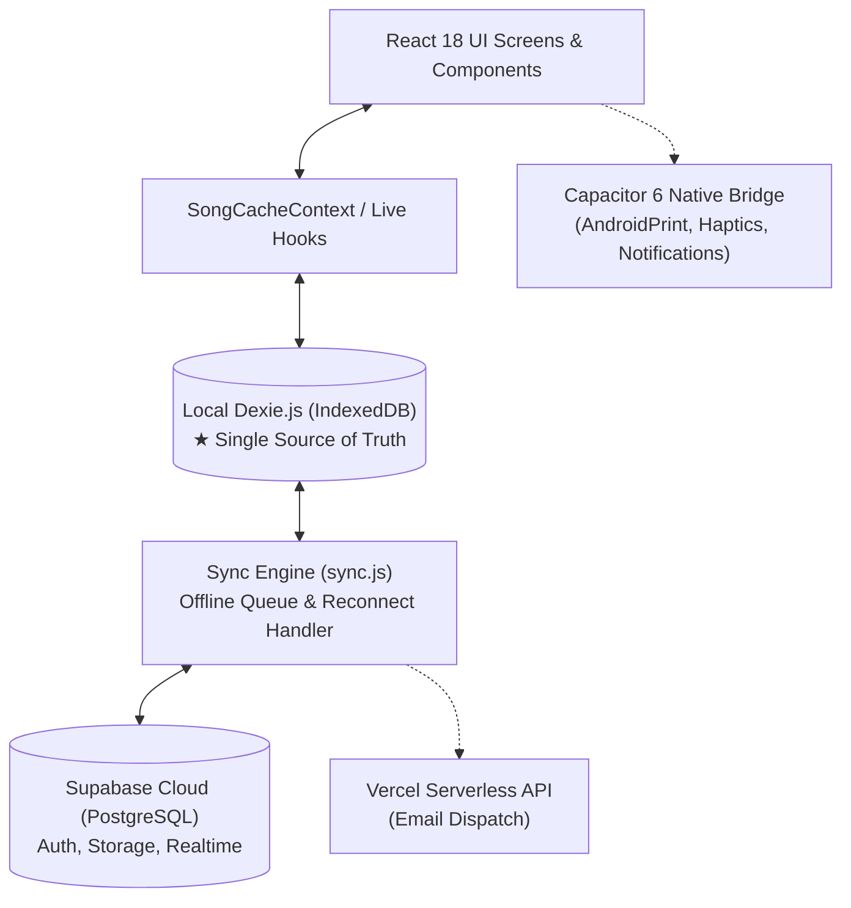

# Selah Architecture & Technical Blueprint

> **Version:** 1.0.0  
> **Status:** Active / Source of Truth  
> **Governing Skill:** Graphify & Ponytail  
> **Target:** 100% Offline-First | Sub-50ms Reactivity | Zero Code Breakage

---

## 1. System Topology Overview

Selah is built on an **Offline-First, Reactive Client-Side Architecture**. It operates as a web Single Page Application (SPA), a native Android application via Capacitor 6, and an iOS mobile app.



### Tech Stack Specifications
- **Client Framework:** React 18.3.1 (Vite 6.1.0, ES2022+)
- **Styling Engine:** Tailwind CSS 3.4.17 + CSS Custom Properties
- **Routing:** `react-router-dom` 6.28.2 (`HashRouter` for Capacitor native file-URL compatibility)
- **Local Persistence:** Dexie.js 4.0.11 (`dexie-react-hooks` with `useLiveQuery`)
- **Cloud Backend-as-a-Service:** Supabase (`@supabase/supabase-js` 2.48.1)
- **Native Runtime:** Capacitor 6.2.0 (`@capacitor/android`, `@capacitor/core`, `@capacitor/app`, `@capacitor/local-notifications`)
- **Iconography:** Phosphor Icons (`@phosphor-icons/react` 2.1.10)
- **Testing:** Vitest 2.1.9 (`jsdom`, `fake-indexeddb`)

---

## 2. The Offline-First Data Contract

### 2.1 Single Source of Truth
Local IndexedDB (Dexie) is the **absolute source of truth** for all application state. 
- UI reads and writes **NEVER** wait for a network roundtrip or Supabase response.
- Every create, update, or delete operation writes immediately to Dexie.
- `useLiveQuery` hooks automatically re-render React components within `<16ms`.

### 2.2 Write-Through Background Sync Pipeline

```
[User Action]
      │
      ▼
1. Write to Dexie Local DB ──► [UI Updates Instantly via useLiveQuery]
      │
      ▼
2. Check Network Status
     ├── Online  ──► Push to Supabase Cloud ──► Realtime broadcast to peers
     └── Offline ──► Append record to Dexie `syncQueue`
                           │
                           ▼ (on window 'online' event)
                     Process queue with exponential backoff
```

### 2.3 Conflict Resolution Strategy
- **Strategy:** Timestamp-based Last-Write-Wins (LWW) utilizing UTC ISO timestamps (`updated_at`).
- If a remote record has a newer `updated_at` than the local Dexie timestamp, local cache hydrates the remote data.
- User-created local songs and setlists are assigned temporary deterministic IDs and synced cleanly to UUIDs in Supabase.

---

## 3. Core Engineering Subsystems

### 3.1 Musical Transposition Engine (`src/utils/chords.js`)
- **12-Tone Chromatic Scale:**
  ```javascript
  const CHROMATIC_SCALE = ['C', 'C#', 'D', 'D#', 'E', 'F', 'F#', 'G', 'G#', 'A', 'A#', 'B'];
  ```
- **Enharmonic Mapping:** Automatically normalizes flats to sharps (`Db` → `C#`, `Eb` → `D#`, `Bb` → `A#`).
- **Parsing Regex:** Chords are extracted and transposed using bracket-delimited expressions:
  ```javascript
  const CHORD_REGEX = /\[([A-G][b#]?(?:maj|min|m|M|dim|aug|sus[24]?|[0-9]+)?(?:\/[A-G][b#]?)?)\]/g;
  ```
- **Compound / Slashed Chords:** Correctly splits and transposes bass inversion notes (e.g., `[D/F#]` transposed up 2 semitones becomes `[E/G#]`).
- **Clean Lyrics Generator:** `stripChords(lyrics)` strips all `[...]` bracketed annotations, yielding clean text for projection and vocalists.

### 3.2 Lyrics & Syllable Separator (`src/utils/lyrics.js`)
- Parses raw song lyrics into structured section objects:
  - Sections: `[Verse 1]`, `[Chorus]`, `[Bridge]`, `[Intro]`, `[Outro]`.
  - Splits chords from lyrics to render chord overlays in monospace font directly aligned over lyric syllables.

### 3.3 Live Stage Player Engine (`src/screens/SetlistPlayerScreen.jsx`)
- **Continuous Auto-Scroll:**
  - Implemented via `window.requestAnimationFrame`.
  - Increments scroll position using `window.scrollBy({ top: speed, behavior: 'auto' })`.
  - Avoids `behavior: 'smooth'` within animation frame loops to prevent event-queue rubber-banding and frame drops.
- **Section Boundary Indexing:**
  - Caches DOM positions of each song in a setlist.
  - Quick-jump drawer allows instantaneous jumping between setlist songs without breaking full-screen stage mode.

### 3.4 Notifications & Scheduling Subsystem (`src/utils/notifications.js`, `src/utils/notificationPreferences.js`)
- **Multi-Channel Dispatch:**
  1. **Dexie Notification Store:** In-app notification tray with read/unread tracking.
  2. **Capacitor LocalNotifications:** Native OS status bar notifications for rehearsal reminders.
  3. **Vercel Serverless Email API (`/api/send-assignment-email`):** Dispatches automated minister assignment emails.
- **Preference Guard:** Checks recipient's notification preferences before dispatch. If `email_enabled === false`, email sending is silently suppressed while preserving the in-app notification.

### 3.5 Native Mobile Bridges (`src/main.jsx` & Capacitor)
- **`AndroidPrint` Bridge Override:**
  ```javascript
  if (window.AndroidPrint && typeof window.AndroidPrint.print === 'function') {
    window.print = function() { window.AndroidPrint.print(); };
  }
  ```
- **Hardware Back Button Handler:** Intercepts Android hardware back button via `@capacitor/app`. If a modal or bottom sheet is open, closes it; if on a child route, navigates back; if on root, prompts exit confirmation.
- **Stage Wakelock:** Prevents screen dimming or device sleep during active live performance mode.

---

## 4. Database Schema Specifications

### 4.1 Dexie.js (IndexedDB Schema)

```javascript
db.version(4).stores({
  songs: '++id, title, artist, category, language, originalKey, tempo, dateAdded',
  setlists: '++id, title, date, *songIds',
  settings: '&key',
  syncQueue: '++id, table, action, recordId, timestamp',
  notifications: '++id, type, title, timestamp, is_read',
  schedule_reminders: '++id, schedule_id, minister_id, reminder_time, status'
});
```

### 4.2 Supabase PostgreSQL Cloud Schema

```sql
-- Profiles & Roles
CREATE TABLE profiles (
  id UUID REFERENCES auth.users ON DELETE CASCADE PRIMARY KEY,
  username TEXT UNIQUE,
  email TEXT,
  role TEXT DEFAULT 'Member' CHECK (role IN ('Admin', 'Worship Leader', 'Musician', 'Vocalist', 'Member')),
  quick_pin TEXT,
  accent_color TEXT DEFAULT '#D4AF37',
  created_at TIMESTAMPTZ DEFAULT NOW(),
  updated_at TIMESTAMPTZ DEFAULT NOW()
);

-- Worship Songs
CREATE TABLE songs (
  id UUID DEFAULT gen_random_uuid() PRIMARY KEY,
  user_id UUID REFERENCES auth.users(id),
  title TEXT NOT NULL,
  artist TEXT,
  original_key TEXT NOT NULL,
  tempo INTEGER,
  category TEXT CHECK (category IN ('Fast', 'Slow')),
  language TEXT DEFAULT 'English',
  lyrics TEXT NOT NULL,
  created_at TIMESTAMPTZ DEFAULT NOW(),
  updated_at TIMESTAMPTZ DEFAULT NOW()
);

-- Setlists
CREATE TABLE setlists (
  id UUID DEFAULT gen_random_uuid() PRIMARY KEY,
  user_id UUID REFERENCES auth.users(id),
  title TEXT NOT NULL,
  date DATE NOT NULL,
  notes TEXT,
  prepared_by TEXT,
  song_ids JSONB DEFAULT '[]'::jsonb,
  song_keys JSONB DEFAULT '{}'::jsonb,
  created_at TIMESTAMPTZ DEFAULT NOW(),
  updated_at TIMESTAMPTZ DEFAULT NOW()
);

-- Service Schedules & Assignments
CREATE TABLE service_schedules (
  id UUID DEFAULT gen_random_uuid() PRIMARY KEY,
  setlist_id UUID REFERENCES setlists(id) ON DELETE SET NULL,
  title TEXT NOT NULL,
  service_date TIMESTAMPTZ NOT NULL,
  rehearsal_date TIMESTAMPTZ,
  notes TEXT,
  created_at TIMESTAMPTZ DEFAULT NOW()
);

CREATE TABLE minister_assignments (
  id UUID DEFAULT gen_random_uuid() PRIMARY KEY,
  schedule_id UUID REFERENCES service_schedules(id) ON DELETE CASCADE,
  user_id UUID REFERENCES profiles(id) ON DELETE CASCADE,
  role_assigned TEXT NOT NULL,
  status TEXT DEFAULT 'Pending' CHECK (status IN ('Pending', 'Confirmed', 'Declined')),
  created_at TIMESTAMPTZ DEFAULT NOW()
);

-- Notification Preferences
CREATE TABLE notification_preferences (
  user_id UUID REFERENCES profiles(id) ON DELETE CASCADE PRIMARY KEY,
  email_enabled BOOLEAN DEFAULT TRUE,
  in_app_enabled BOOLEAN DEFAULT TRUE,
  rehearsal_reminder_hours INTEGER DEFAULT 24,
  updated_at TIMESTAMPTZ DEFAULT NOW()
);
```

---

## 5. Security & Role-Based Access Control (RBAC)

| Role | Song Library | Setlists | Schedules & Assignments | Team Management |
|:---|:---|:---|:---|:---|
| **Admin** | Full CRUD | Full CRUD | Full CRUD | Full CRUD |
| **Worship Leader** | Full CRUD | Full CRUD | Create / Assign Ministers | View Team |
| **Musician** | View & Transpose | View & Transpose | View Own Assignments | View Team |
| **Vocalist** | View & Lyrics Mode | View & Lyrics Mode | View Own Assignments | View Team |
| **Member** | View Only | View Only | View Only | None |

- **Row Level Security (RLS):** Enabled on all Supabase tables. Non-admin users are restricted to reading authorized setlists and modifying their own profiles.
- **PIN Authentication:** 4-digit numeric PIN is validated against `profiles.quick_pin` and cached locally in private storage for quick stage tablet unlocking.

---

## 6. Testing & Regression Guardrails

All code changes and refactoring must pass the automated test suite before merging or release.

```bash
cd selah-app
npm run test
```

### Verified Test Suites (126 Tests Passing):
1. **`dexie.test.js` (26 tests):** Database seeding of 422 songs, CRUD operations, case-insensitive search, and re-seed thresholds.
2. **`chords.test.js` (45 tests):** 12-key chromatic transposition, enharmonic normalization, slashed chords, and chord stripping.
3. **`lyrics.test.js` (15 tests):** Bracket parsing, section header recognition, and chord/lyric separation.
4. **`sync.test.js` (8 tests):** Bidirectional sync, offline queue push, and error recovery.
5. **`notifications.test.js` (5 tests):** In-app notification creation, Dexie persistence, and minister reminder dispatch.
6. **`notificationPreferences.test.js` (6 tests):** Preference overrides and email suppression.
7. **`rbac.test.js` (6 tests):** Permission boundaries and role verification.
8. **`avatar.test.js` (6 tests):** Avatar selection and fallback rendering.
9. **`features.test.js` (8 tests):** Feature flags and feature state caching.
10. **`backHandler.test.js` (1 test):** Android hardware back button lifecycle handling.
